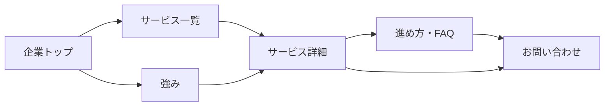
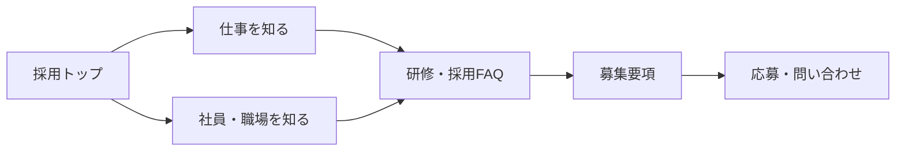

# コアフューテック 新サイトマップ・導線設計 確定推奨案 v1.0

策定日：2026年10月23日  
対象：`https://www.corefutec.co.jp/` と `https://www.recruit.corefutec.co.jp/` の企業・採用サイト統合  
制作方式：まず静的HTML/CSS/JavaScriptで構築し、後からWordPressに移行  
デザイン参考：`https://solvvy.co.jp/`（情報・文言・意匠の複製はしない）

## 0. この案の位置付け

**以下を静的制作の基準となる新サイトマップとして採用することを推奨します。** 公開前に人事・営業・管理部門が内容を確認します。現行サイトへの変更や301設定はまだ行っていません。

出発点は公式に公開されていた企業側26件と採用側9件の**合計35 URL候補**です。これは管理画面・サーバー内を含む「全URL数」の保証ではありません。旧URL台帳は本書第5章に収録します。

### 確定する情報設計上の判断

1. 正式な新ドメインは `www.corefutec.co.jp` とし、採用情報は `/recruit/` 以下に配置します。
2. 「企業の担当者」「求職者」の2つの閲覧目的を分け、全ページからそれぞれ適切なCTAへ到達できる設計にします。
3. 企業サイトの既存サービス・会社概要・記事URLは、原則変更しません。
4. 採用サイトの「部署紹介」と「職場の雰囲気」は1ページへ統合します。
5. 採用募集要項の複数版は、新しい正規募集要項へ統合します。ただし旧版の正体・正式条件の確認は必須です。
6. 追加する詳細説明は既存実績・社内確認済み情報に限定し、顧客事例や実績数字は創作しません。
7. 旧ドメインの各URLは対応する新ページへ301転送する方針です。旧ドメインの保有・証明書・設定を維持します。

## 1. 新サイトマップ

ラベル：`[既存]` URL維持、`[新設]` 新URL、`[移転]` 採用ドメイン等から移行、`[統合]` 複数旧ページを集約、`[条件付]` 掲載資料がそろったら公開。

```text
www.corefutec.co.jp
│
├─ /                           企業トップ [既存・全面改修]
│
├─ サービス
│  ├─ /services/               サービス一覧 [新設]
│  ├─ /third-party-verification/  ソフトウェアテスト・第三者検証 [既存]
│  ├─ /software-development/   ソフトウェア開発 [既存]
│  ├─ /solution/               ソリューション総覧 [既存・再構成]
│  │  ├─ /solution/log-analysis/           ログ解析 [新設]
│  │  └─ /solution/security-assessment/   セキュリティ評価 [新設]
│  └─ /process/                相談から納品まで [新設]
│
├─ /strengths/                 コアフューテックの強み [新設]
├─ /cases/                     事例・実績 [条件付]
├─ /faq/                       法人のお客様向けFAQ [新設]
├─ /product/                   自社製品・e伝之介くん [既存]
│                               └─ 製品専用サイトへ外部リンク
│
├─ /company/                   企業情報トップ [既存・改修]
│  ├─ /company/greetings-from-the-president/  代表ご挨拶 [既存]
│  ├─ /company/management-philosophy/         経営理念 [既存]
│  ├─ /company/company-profile/               会社概要・沿革 [既存]
│  ├─ /company/access/                        アクセス [既存]
│  └─ /company/technology-and-media/          資格・認定・メディア [既存]
│
├─ お知らせ・コラム
│  ├─ /category/information/             お知らせ一覧 [既存]
│  ├─ /category/software-test-column/    技術コラム一覧 [既存]
│  └─ 既存個別記事 8 URL             [URL保持・テンプレート刷新]
│
├─ /recruit/                   採用トップ [移転・全面改修]
│  ├─ /recruit/message/         求める人物像 [移転]
│  ├─ /recruit/work/            仕事内容・キャリア [移転]
│  ├─ /recruit/people/          社員の声 [移転・再構成]
│  ├─ /recruit/culture/         部署・働く環境 [統合]
│  ├─ /recruit/training/        研修・育成制度 [移転]
│  ├─ /recruit/jobs/            募集要項（新卒・中途）[統合]
│  ├─ /recruit/faq/             採用FAQ・選考フロー [新設]
│  └─ /recruit/entry/           応募・採用問い合わせ [移転]
│
├─ /contact/                   法人・一般お問い合わせ [既存]
├─ /privacy-policy/            プライバシーポリシー [既存]
├─ /site-map/                  サイトマップ [既存・更新]
└─ /wp-content/uploads/...     法定資料PDF [既存ファイル保持]
```

`/cases/` は構成案に含めますが、**実在する案件の内容・掲載許可が確認できるまで一般公開しません**。公開できる事例がない段階では `/strengths/` 内に実績の考え方と対応範囲だけを掲載し、空のページを設けません。

## 2. グローバルナビゲーション

| 領域 | 第1階層 | 展開・リンク | CTA |
|---|---|---|---|
| 法人 | サービス | サービス一覧、ソフトウェアテスト、開発、ソリューション | お問い合わせ |
| 法人 | 強み・実績 | 強み、導入の流れ、事例（公開後） | 相談する |
| 法人 | 自社製品 | 製品紹介 | 製品詳細へ |
| 共通 | 企業情報 | 代表挨拶、理念、会社概要、アクセス、認定 | — |
| 求職者 | 採用情報 | 採用トップ、仕事内容、社員の声、働く環境、募集要項 | 募集要項を見る |
| 共通 | お知らせ・コラム | お知らせ、技術コラム | — |
| 共通 | お問い合わせ | 問い合わせ専用ページ | 常時表示 |

- PCはブランドロゴ左、ナビ中央、目立つお問い合わせCTA右。採用情報も常時見えるようにします。
- 採用ページでは上部を採用用サブナビに切り替え、「募集要項」「応募する」を明確に表示します。
- スマートフォンでは開閉メニューの上部に「サービス」「採用情報」の2入口を設け、深すぎるメニュー階層を避けます。
- パンくずを全下層ページに配置します。フッターには法定資料・プライバシー・サイトマップ・企業問い合わせ・採用エントリーを置きます。

## 3. 追加・統合・縮小の採用決定

### 新設するページ

| 優先順位 | ページ | 目的 | 掲載内容の設計 |
|---|---|---|---|
| P0 | `/services/` | 3分野を比較・選択しやすくする | 課題別入口、対応サービス、各詳細へのリンク |
| P0 | `/strengths/` | 「なぜ同社か」を分かりやすくする | 品質への考え方、認定、経験、技術領域。数値は確認後 |
| P0 | `/process/` | 初回相談の心理的負担を下げる | 問い合わせ→ヒアリング→提案→実行→納品など実際の工程を確認して記載 |
| P0 | `/faq/` | 法人担当者の疑問を解消する | 依頼可能範囲、見積条件、進め方、秘密保持など正式回答のみ |
| P0 | `/recruit/faq/` | 応募前の疑問を解消する | 新卒・中途の選考、応募書類、研修、勤務条件等を人事確認後掲載 |
| P1 | `/solution/log-analysis/` | ログ解析の検索・相談入口を明確にする | 課題、用途、対応範囲、納品物、相談CTA |
| P1 | `/solution/security-assessment/` | セキュリティ評価のサービス内容を明確にする | 評価対象、手法、対応範囲、納品物、相談CTA |
| P1・条件付 | `/cases/` | 事例を根拠にサービスを選べるようにする | 許諾済み事例のみ。匿名事例も実際の内容に限定 |

**公開基準：** P0の5ページは静的版の公開対象、P1の2サービス詳細はサービス担当者の確認を受けて公開、事例は承認が取れたときだけ公開します。ページが増えすぎる場合でも優先度と役割の違いを維持します。

### 統合・再構成するページ

| 旧ページ・情報 | 新しい扱い | 判断理由 |
|---|---|---|
| 採用「部署の紹介」＋「職場の雰囲気」 | `/recruit/culture/` の「チーム」「働く環境」の2セクションに統合 | 求職者が職場像を1ページで把握できる。独立ページにするほどの新資料が現状ない |
| `recruit.html`＋旧版候補 `recruitn.html` | `/recruit/jobs/` に現行の募集条件を一本化 | 相違する条件が並ぶ危険を解消。どちらが現行かは人事が判定 |
| 企業の採用問い合わせ `/recruit-contact/` | `/recruit/entry/` に移動 | 企業問い合わせと採用応募を混同させない |
| ソリューション既存長文 | `/solution/` は概要に絞り、2つの専門下層ページへ整理 | 選択肢と詳細を分離して読みやすくする |
| 企業トップで重複する説明 | 各サービス詳細、強みページに集約 | トップは価値訴求・主要導線に集中 |
| 古いイベント・入社式の記事 | URLを残し、日付つきの記事アーカイブへ | 削除によるリンク切れを防ぎ、最新情報とは区別 |

### 削除・非掲載の方針

- **この時点では既存の公開URLの恒久削除を決定しません。** 重複ページには301転送を設定します。
- 根拠のない顧客ロゴ、成果数字、口コミは作りません。
- 社員インタビューの古い写真・所属・在籍情報は現況確認し、未承認のものは公開しません。
- 古い求人の給与・条件は確認まで新サイトに複製しません。
- 法定PDFの旧版は無断で消しません。対象期間・最新版への導線を明記します。

## 4. 全体の導線設計

### 法人顧客：新規相談まで



1. トップのファーストビューには「何を提供している会社か」「どんな課題を相談できるか」「相談CTA」の3点を置きます。
2. 企業担当者の課題別カードから3サービスへ遷移させ、技術用語を知らなくても選べるようにします。
3. 詳細ページには「対象課題・対応範囲・進め方・根拠・関連コラム・CTA」を共通化します。
4. 問い合わせページでは「テスト／開発／ソリューション／その他」の関心分野を選択できるよう検討します（フォーム仕様は後日確定）。

### 求職者：理解から応募まで



1. 採用トップは企業トップと同じブランドを使いつつ、より人物・職場写真を前面に出します。
2. 「仕事を知る」「人を知る」「環境を知る」の3入口を設けます。
3. どの採用ページからも「募集要項」へ1クリック、そこから「応募」へ1クリックで進めます。
4. 募集要項は新卒・中途をページ内タブまたはアンカーで切り替え、条件を混在させません。

### 自社製品・その他

- 製品関心者：企業トップ／サービス → `/product/` → 製品専用サイト。外部遷移はリンク先を明示します。
- 会社調査者：企業トップ／フッター → `/company/` → 会社概要・アクセス・資格など。
- 記事流入者：技術コラム → 関連するサービス詳細 → 法人問い合わせ。
- すべてのページ：パンくず、共通フッター、CTAで現在地と次の行動が分かるようにします。

### 主要トップページのセクション順

**企業トップ：** キービジュアルと訴求 → サービス3領域 → 強み／信頼性 → ソリューション・製品 → 事例（承認時）→ お知らせ／技術コラム → 相談CTA。

**採用トップ：** メッセージとキービジュアル → 仕事を知る → 社員の声 → チーム・職場環境 → 研修制度 → 募集要項 → 応募CTA。

Solvvyの参考点は「余白の設計・文字の階層・画面切り替え・モーションの質」として解釈し、情報が読めなくなるような過剰なアニメーションは避けます。

## 5. 旧URL → 新URL移行マトリクス（公開調査35件）

表内パスのホストは企業側が `https://www.corefutec.co.jp`、採用側が `https://www.recruit.corefutec.co.jp` です。`同じ` は企業側URLを保持する意味です。

### A. 企業サイトの固定ページ15件

| # | 旧URL（パス） | 新URL（パス） | 処理 |
|---|---|---|---|
| 1 | `/` | 同じ | コンテンツ刷新 |
| 2 | `/third-party-verification/` | 同じ | テンプレート刷新 |
| 3 | `/software-development/` | 同じ | テンプレート刷新 |
| 4 | `/solution/` | 同じ | 総覧化、詳細2ページを新設 |
| 5 | `/product/` | 同じ | 製品紹介と外部リンクを整理 |
| 6 | `/company/` | 同じ | 会社案内総覧へ再構成 |
| 7 | `/company/greetings-from-the-president/` | 同じ | 現況確認後に掲載 |
| 8 | `/company/management-philosophy/` | 同じ | 維持 |
| 9 | `/company/company-profile/` | 同じ | 最新化 |
| 10 | `/company/access/` | 同じ | 最新化 |
| 11 | `/company/technology-and-media/` | 同じ | 認定・実績を整理 |
| 12 | `/contact/` | 同じ | 法人・一般用として維持 |
| 13 | `/recruit-contact/` | `/recruit/entry/` | **301転送**、フォーム移設 |
| 14 | `/privacy-policy/` | 同じ | 管理者確認のうえ維持 |
| 15 | `/site-map/` | 同じ | 新構成を反映 |

### B. 企業サイトのアーカイブ・記事・資料11件

| # | 旧URL（パス） | 新URL | 処理 |
|---|---|---|---|
| 16 | `/category/information/` | 同じ | お知らせ一覧 |
| 17 | `/category/software-test-column/` | 同じ | 技術コラム一覧 |
| 18 | `/8月4日-東京都市大学【オンライン】学内合同企業/` ※ | 同じ | 過去のお知らせとして維持 |
| 19 | `/7月7日-インターンシップ合同マッチング会/` ※ | 同じ | 過去のお知らせとして維持 |
| 20 | `/創立40周年を迎えることができました/` ※ | 同じ | 記念記事として維持 |
| 21 | `/management-policy/` | 同じ | 維持 |
| 22 | `/initiation-ceremony-for-2023/` | 同じ | 維持 |
| 23 | `/e-dennosuke-in-newspaper/` | 同じ | 維持、製品から内部リンク |
| 24 | `/four-advantages-of-third-party-verification-for-small-and-medium-sized-software-development/` | 同じ | 維持、サービスから内部リンク |
| 25 | `/three-reassurances-necessary-for-software-testing/` | 同じ | 維持、サービスから内部リンク |
| 26 | `/wp-content/uploads/2024/06/corefutec_margin_rate_2024.pdf` | 同じ | PDF保持、対象期間を表示 |

※ #18〜#20の日本語パスは読みやすい表示用です。**サーバーのリダイレクト・移行実装時は表記からURLを再生成せず、次の完全URLをそのまま移行台帳に登録します。**

- #18 `https://www.corefutec.co.jp/8%E6%9C%884%E6%97%A5-%E6%9D%B1%E4%BA%AC%E9%83%BD%E5%B8%82%E5%A4%A7%E5%AD%A6%E3%80%90%E3%82%AA%E3%83%B3%E3%83%A9%E3%82%A4%E3%83%B3%E3%80%91%E5%AD%A6%E5%86%85%E5%90%88%E5%90%8C%E4%BC%81%E6%A5%AD/`
- #19 `https://www.corefutec.co.jp/7%E6%9C%887%E6%97%A5-%E3%82%A4%E3%83%B3%E3%82%BF%E3%83%BC%E3%83%B3%E3%82%B7%E3%83%83%E3%83%97%E5%90%88%E5%90%8C%E3%83%9E%E3%83%83%E3%83%81%E3%83%B3%E3%82%B0%E4%BC%9A/`
- #20 `https://www.corefutec.co.jp/%E5%89%B5%E7%AB%8B40%E5%91%A8%E5%B9%B4%E3%82%92%E8%BF%8E%E3%81%88%E3%82%8B%E3%81%93%E3%81%A8%E3%81%8C%E3%81%A7%E3%81%8D%E3%81%BE%E3%81%97%E3%81%9F/`

### C. 旧採用ドメイン9件

| # | 旧採用URL（パス） | 新サイトURL（パス） | 処理 |
|---|---|---|---|
| 27 | `/` | `/recruit/` | **301転送** |
| 28 | `/message.html` | `/recruit/message/` | **301転送** |
| 29 | `/senior.html` | `/recruit/people/` | **301転送** |
| 30 | `/jobs.html` | `/recruit/work/` | **301転送** |
| 31 | `/workplace.html` | `/recruit/culture/#teams` | **301転送は `/recruit/culture/` へ**。アンカーまでの転送可否は実装時確認 |
| 32 | `/workplace02.html` | `/recruit/culture/#environment` | **301転送は `/recruit/culture/` へ**。セクション内導線を設置 |
| 33 | `/workplace03.html` | `/recruit/training/` | **301転送** |
| 34 | `/recruit.html` | `/recruit/jobs/` | **301転送**。現行募集条件を人事確認 |
| 35 | `/recruitn.html` | `/recruit/jobs/`（暫定） | **公開前に要判定**。旧版／別募集枠の可能性を人事・サーバーで確認し、重複なら301 |

**重要：** #35はページの内容が#34と異なるため、確認なしに同じ募集要項として扱いません。別制度の現行ページなら専用掲載枠を設計し直します。旧ドメイン全体を一律 `/recruit/` に転送する運用は避けます。

## 6. テンプレート・CMSを前提とした静的設計

| テンプレート | 主な対象 | 後日WordPressで管理するもの |
|---|---|---|
| トップページ | `/`、`/recruit/` | セクション見出し、お知らせ枠、画像 |
| 一覧・ハブ | `/services/`、`/solution/`、`/company/`、記事カテゴリ | カード、リンク、並び順 |
| 詳細ページ | サービス、強み、進め方、会社下層、研修、文化 | セクション、写真、本文 |
| 記事一覧・本文 | お知らせ、技術コラム | 投稿、カテゴリ、日付、本文、画像 |
| 募集要項 | `/recruit/jobs/` | 新卒・中途の募集種別、勤務条件、公開状態 |
| 社員紹介 | `/recruit/people/` | 社員プロフィール、取材日、職種、公開可否 |
| FAQ | `/faq/`、`/recruit/faq/` | 質問、回答、分類、表示順 |
| フォーム | `/contact/`、`/recruit/entry/` | 送信、通知、同意記録、スパム対策（CMS化時） |

- `Header`、`Footer`、`Breadcrumb`、`CTA`、`Card`、`Accordion`、`SectionHeading`、`ArticleLayout`を共通コンポーネント化します。
- PC・スマートフォン双方で、見出しの読みやすさと入力しやすさを先に満たします。動きは視差、スクロール表示、ホバー反応などを少数のルールに統一します。ユーザーが動きを減らす設定をした場合は配慮します。
- CMS化前の静的フォームは**送信できると誤認させないデモ**とし、実送信・通知・個人情報の処理はWordPress導入時に実装・試験します。
- 画像・社員・顧客・資格マークの利用権限と最新性を確認してから掲載します。
- 一覧・本文のパーマリンク、SEOタイトル、メタ情報、canonical、構造化データ、OG画像、XMLサイトマップはCMS化の要件に含めます。

## 7. 制作工程と検収基準

1. **構成承認：** 本書のツリー・ナビ・統合方針を決定します。採用募集要項の正本、掲載可否、会社データの確認担当者を決めます。
2. **ワイヤーフレーム：** 企業トップ、サービス詳細、会社情報、採用トップ、仕事、社員紹介、募集要項、フォームの代表画面を設計します。
3. **デザインシステム：** 色、書体、余白、カード、ボタン、アニメーション、PC／スマホの動作を統一します。Solvvyは表現水準の参考に留めます。
4. **静的サイト制作：** 上記テンプレートを作り、全ページへ適用します。実コンテンツが未承認の箇所は公開不可として管理します。
5. **導線検証：** 各サービスから法人問い合わせへ、各採用ページから募集要項・応募へ、最大2クリック程度で到達できるか検証します。
6. **移行準備：** 全URLクロール・WordPress一覧・Search Console等と照合して台帳を補完し、301ルール、古い採用ドメインの運用、フォーム通知先を確定します。
7. **WordPress化・公開：** テンプレートをテーマ化し、記事・募集条件・FAQ等をCMS管理へ移します。フォーム実送信、モバイル、速度、アクセシビリティ、404・301・SEOを検証してから公開します。

### サイトマップ案の採否と別に、公開前に必ず確認する項目

| 事項 | 確認先 | 未確認の場合の扱い |
|---|---|---|
| `recruit.html` と `recruitn.html` の正誤・条件 | 採用担当 | 募集条件は未公開／旧URLの転送判断を保留 |
| 社員インタビューの所属・掲載同意 | 採用担当、本人 | 該当コンテンツは非公開 |
| 資格・認定・事業実績の最新データ | 事業・管理担当 | 数値・ロゴを掲載しない |
| 顧客案件の掲載許可 | 営業・顧客窓口 | `/cases/` は非公開 |
| サービス提供範囲・標準工程・FAQ回答 | 技術・営業担当 | 記述確定まで公開しない |
| 現行URL・旧採用サーバー・検索流入 | サイト管理者 | 301設定・旧ドメイン停止を保留 |
| 個人情報・フォーム通知先・法定PDF | 管理担当 | 本番公開前に再確認 |

## 8. 今回の推奨結論

**静的制作を進める基準としてはこのサイトマップで確定**し、企業サイト・採用サイトを一つのデザインシステムへ統合します。追加するP0の5ページと採用トップを先に設計し、その後にサービス詳細・会社下層・採用下層・記事へ横展開します。既存35URL候補は第5章の対応方針で保護し、管理画面／サーバー調査で新たに判明したURLは公開前に台帳へ追加します。

本書は情報設計・制作順の決定案であり、正しい募集条件や非公開の実績を推測するものではありません。

## 参照元

- [現行企業サイト](https://www.corefutec.co.jp/)
- [現行企業サイトマップ](https://www.corefutec.co.jp/site-map/)
- [現行採用サイト](https://www.recruit.corefutec.co.jp/)
- [デザイン参考 Solvvy](https://solvvy.co.jp/)
- 先行調査文書：`corefutec_site_structure_audit.md`（同作業フォルダー）
